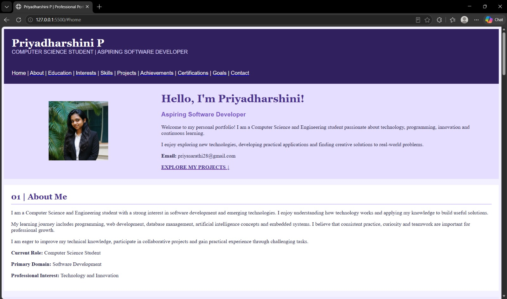
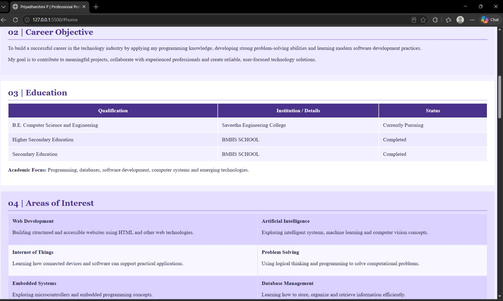
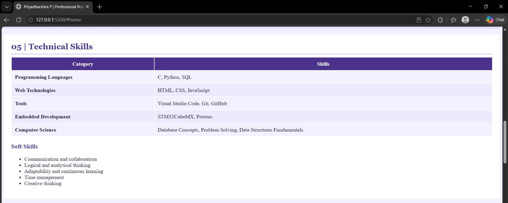
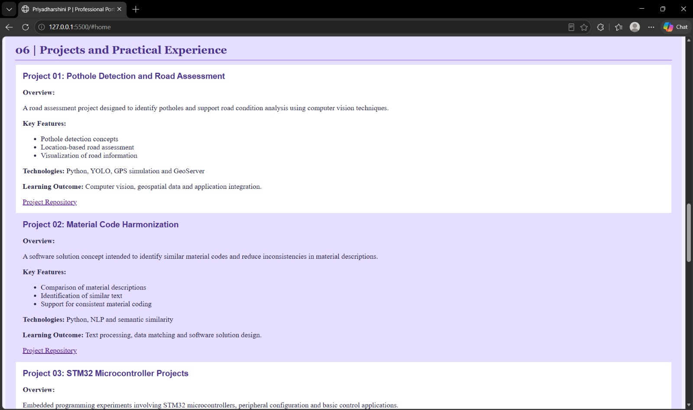
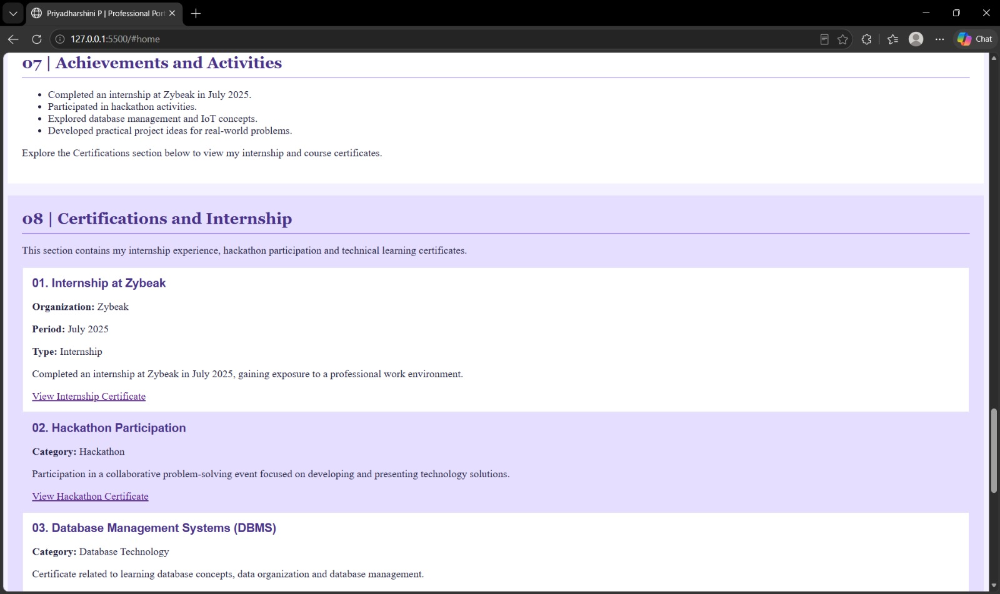
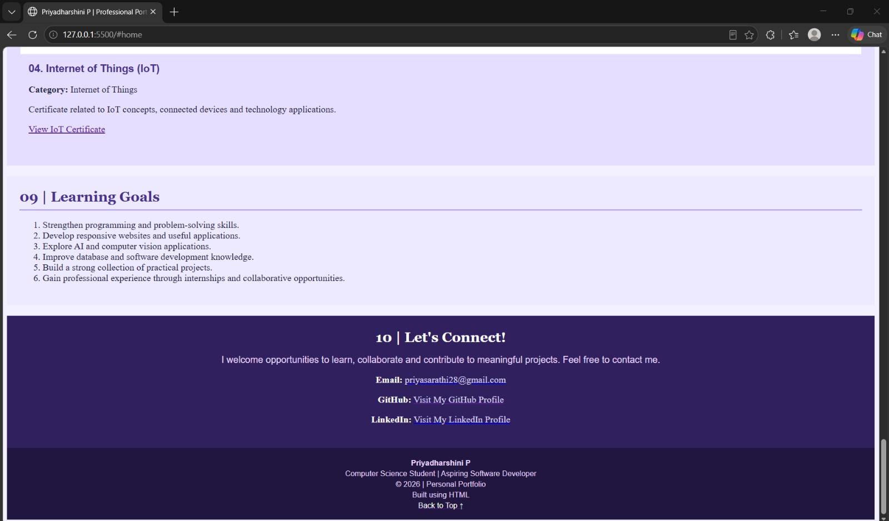

# Ex01 Portfolio
## Date: 25-10-2026
## AIM
To create a Portfolio using HTML and CSS.

## ALGORITHM
### STEP 1
Create an HTML file named `index.html`.

### STEP 2
Add the portfolio title, introduction, and personal details.

### STEP 3
Include sections for areas of interest, projects, certificates, and contact details.

### STEP 4
Add a profile image using the HTML image tag.

### STEP 5
Use HTML tags to organize the content and layout.

### STEP 6
Add links to projects and certificates.

### STEP 7
Open the HTML file in a web browser to check its appearance and functionality.

### STEP 8
Correct errors and refine the content placement.

### STEP 9
Create a GitHub repository for the portfolio.

### STEP 10
Upload `index.html`, the profile image, and certificate files to the repository.

### STEP 11
Commit and push the project files to GitHub using Git.

### STEP 12
Open the repository settings and navigate to the Pages section.

### STEP 13
Enable GitHub Pages by selecting the `main` branch and the root folder as the deployment source.

### STEP 14
Save the settings and open the generated GitHub Pages URL to view the published portfolio.

## PROGRAM
```
<!DOCTYPE html>
<html lang="en">
<head>
    <meta charset="UTF-8">
    <meta name="viewport" content="width=device-width, initial-scale=1.0">
    <title>Priyadharshini P | Professional Portfolio</title>
</head>

<body bgcolor="#F3F0FF" text="#252344">

<header>
    <table width="100%" bgcolor="#30205D" cellpadding="22">
        <tr>
            <td>
                <font face="Georgia" color="#FFFFFF" size="6">
                    <b>Priyadharshini P</b>
                </font>
                <br>
                <font face="Arial" color="#DDD6FE" size="3">
                    COMPUTER SCIENCE STUDENT | ASPIRING SOFTWARE DEVELOPER
                </font>
            </td>
        </tr>
        <tr>
            <td>
                <font face="Arial" color="#FFFFFF">
                    <a href="#home"><font color="#FFFFFF">Home</font></a> |
                    <a href="#about"><font color="#FFFFFF">About</font></a> |
                    <a href="#education"><font color="#FFFFFF">Education</font></a> |
                    <a href="#interests"><font color="#FFFFFF">Interests</font></a> |
                    <a href="#skills"><font color="#FFFFFF">Skills</font></a> |
                    <a href="#projects"><font color="#FFFFFF">Projects</font></a> |
                    <a href="#achievements"><font color="#FFFFFF">Achievements</font></a> |
                    <a href="#certifications"><font color="#FFFFFF">Certifications</font></a> |
                    <a href="#goals"><font color="#FFFFFF">Goals</font></a> |
                    <a href="#contact"><font color="#FFFFFF">Contact</font></a>
                </font>
            </td>
        </tr>
    </table>
</header>

<main>

    <!-- HOME -->
    <section id="home">
        <table width="100%" cellpadding="25" bgcolor="#E5DEFF">
            <tr>
                <td width="30%" align="center">
                    
                </td>
                <td>
                    <font face="Georgia" color="#49318C" size="6">
                        <b>Hello, I'm Priyadharshini!</b>
                    </font>

                    <h3>
                        <font face="Arial" color="#7653C5">
                            Aspiring Software Developer
                        </font>
                    </h3>

                    <p>
                        Welcome to my personal portfolio! I am a
                        Computer Science and Engineering student
                        passionate about technology, programming,
                        innovation and continuous learning.
                    </p>

                    <p>
                        I enjoy exploring new technologies, developing
                        practical applications and finding creative
                        solutions to real-world problems.
                    </p>

                    <p><b>Email:</b> priyasarathi28@gmail.com</p>

                    <a href="#projects">
                        <font color="#49318C">
                            <b>EXPLORE MY PROJECTS ↓</b>
                        </font>
                    </a>
                </td>
            </tr>
        </table>
    </section>

    <br>

    <!-- ABOUT -->
    <section id="about">
        <table width="100%" cellpadding="20" bgcolor="#FFFFFF">
            <tr>
                <td>
                    <font face="Georgia" color="#49318C" size="5">
                        <b>01 | About Me</b>
                    </font>
                    <hr color="#C4B5FD">

                    <p>
                        I am a Computer Science and Engineering student
                        with a strong interest in software development
                        and emerging technologies. I enjoy understanding
                        how technology works and applying my knowledge
                        to build useful solutions.
                    </p>

                    <p>
                        My learning journey includes programming,
                        web development, database management, artificial
                        intelligence concepts and embedded systems.
                        I believe that consistent practice, curiosity
                        and teamwork are important for professional growth.
                    </p>

                    <p>
                        I am eager to improve my technical knowledge,
                        participate in collaborative projects and gain
                        practical experience through challenging tasks.
                    </p>

                    <p><b>Current Role:</b> Computer Science Student</p>
                    <p><b>Primary Domain:</b> Software Development</p>
                    <p><b>Professional Interest:</b> Technology and Innovation</p>
                </td>
            </tr>
        </table>
    </section>

    <br>

    <!-- CAREER OBJECTIVE -->
    <section id="objective">
        <table width="100%" cellpadding="20" bgcolor="#EDE9FE">
            <tr>
                <td>
                    <font face="Georgia" color="#49318C" size="5">
                        <b>02 | Career Objective</b>
                    </font>
                    <hr color="#A78BFA">

                    <p>
                        To build a successful career in the technology
                        industry by applying my programming knowledge,
                        developing strong problem-solving abilities
                        and learning modern software development practices.
                    </p>

                    <p>
                        My goal is to contribute to meaningful projects,
                        collaborate with experienced professionals
                        and create reliable, user-focused technology solutions.
                    </p>
                </td>
            </tr>
        </table>
    </section>

    <br>

    <!-- EDUCATION -->
    <section id="education">
        <table width="100%" cellpadding="20" bgcolor="#FFFFFF">
            <tr>
                <td>
                    <font face="Georgia" color="#49318C" size="5">
                        <b>03 | Education</b>
                    </font>
                    <hr color="#C4B5FD">

                    <table width="100%" cellpadding="12">
                        <tr bgcolor="#49318C">
                            <th><font color="#FFFFFF">Qualification</font></th>
                            <th><font color="#FFFFFF">Institution / Details</font></th>
                            <th><font color="#FFFFFF">Status</font></th>
                        </tr>

                        <tr bgcolor="#F3F0FF">
                            <td>B.E. Computer Science and Engineering</td>
                            <td>Saveetha Engineering College</td>
                            <td>Currently Pursuing</td>
                        </tr>

                        <tr bgcolor="#EDE9FE">
                            <td>Higher Secondary Education</td>
                            <td>BMHS SCHOOL</td>
                            <td>Completed</td>
                        </tr>

                        <tr bgcolor="#F3F0FF">
                            <td>Secondary Education</td>
                            <td>BMHS SCHOOL</td>
                            <td>Completed</td>
                        </tr>
                    </table>

                    <p>
                        <b>Academic Focus:</b>
                        Programming, databases, software development,
                        computer systems and emerging technologies.
                    </p>
                </td>
            </tr>
        </table>
    </section>

    <br>

    <!-- INTERESTS -->
    <section id="interests">
        <table width="100%" cellpadding="20" bgcolor="#E5DEFF">
            <tr>
                <td>
                    <font face="Georgia" color="#49318C" size="5">
                        <b>04 | Areas of Interest</b>
                    </font>
                    <hr color="#A78BFA">

                    <table width="100%" cellpadding="12">
                        <tr bgcolor="#DCD2FF">
                            <td>
                                <b>Web Development</b>
                                <p>Building structured and accessible websites
                                using HTML and other web technologies.</p>
                            </td>
                            <td>
                                <b>Artificial Intelligence</b>
                                <p>Exploring intelligent systems, machine
                                learning and computer vision concepts.</p>
                            </td>
                        </tr>

                        <tr bgcolor="#F8F6FF">
                            <td>
                                <b>Internet of Things</b>
                                <p>Learning how connected devices and software
                                can support practical applications.</p>
                            </td>
                            <td>
                                <b>Problem Solving</b>
                                <p>Using logical thinking and programming
                                to solve computational problems.</p>
                            </td>
                        </tr>

                        <tr bgcolor="#DCD2FF">
                            <td>
                                <b>Embedded Systems</b>
                                <p>Exploring microcontrollers and embedded
                                programming concepts.</p>
                            </td>
                            <td>
                                <b>Database Management</b>
                                <p>Learning how to store, organize and retrieve
                                information efficiently.</p>
                            </td>
                        </tr>
                    </table>
                </td>
            </tr>
        </table>
    </section>

    <br>

    <!-- SKILLS -->
    <section id="skills">
        <table width="100%" cellpadding="20" bgcolor="#FFFFFF">
            <tr>
                <td>
                    <font face="Georgia" color="#49318C" size="5">
                        <b>05 | Technical Skills</b>
                    </font>
                    <hr color="#C4B5FD">

                    <table width="100%" cellpadding="10">
                        <tr bgcolor="#49318C">
                            <th><font color="#FFFFFF">Category</font></th>
                            <th><font color="#FFFFFF">Skills</font></th>
                        </tr>

                        <tr bgcolor="#F3F0FF">
                            <td><b>Programming Languages</b></td>
                            <td>C, Python, SQL</td>
                        </tr>

                        <tr bgcolor="#EDE9FE">
                            <td><b>Web Technologies</b></td>
                            <td>HTML, CSS, JavaScript</td>
                        </tr>

                        <tr bgcolor="#F3F0FF">
                            <td><b>Tools</b></td>
                            <td>Visual Studio Code, Git, GitHub</td>
                        </tr>

                        <tr bgcolor="#EDE9FE">
                            <td><b>Embedded Development</b></td>
                            <td>STM32CubeMX, Proteus</td>
                        </tr>

                        <tr bgcolor="#F3F0FF">
                            <td><b>Computer Science</b></td>
                            <td>Database Concepts, Problem Solving,
                            Data Structures Fundamentals</td>
                        </tr>
                    </table>

                    <h3><font color="#49318C">Soft Skills</font></h3>

                    <ul>
                        <li>Communication and collaboration</li>
                        <li>Logical and analytical thinking</li>
                        <li>Adaptability and continuous learning</li>
                        <li>Time management</li>
                        <li>Creative thinking</li>
                    </ul>
                </td>
            </tr>
        </table>
    </section>

    <br>

    <!-- PROJECTS -->
    <section id="projects">
        <table width="100%" cellpadding="20" bgcolor="#E5DEFF">
            <tr>
                <td>
                    <font face="Georgia" color="#49318C" size="5">
                        <b>06 | Projects and Practical Experience</b>
                    </font>
                    <hr color="#A78BFA">

                    <table width="100%" cellpadding="15">

                        <tr bgcolor="#FFFFFF">
                            <td>
                                <font face="Arial" color="#49318C" size="4">
                                    <b>Project 01: Pothole Detection
                                    and Road Assessment</b>
                                </font>

                                <p><b>Overview:</b></p>
                                <p>
                                    A road assessment project designed
                                    to identify potholes and support
                                    road condition analysis using
                                    computer vision techniques.
                                </p>

                                <p><b>Key Features:</b></p>
                                <ul>
                                    <li>Pothole detection concepts</li>
                                    <li>Location-based road assessment</li>
                                    <li>Visualization of road information</li>
                                </ul>

                                <p><b>Technologies:</b>
                                Python, YOLO, GPS simulation and GeoServer</p>

                                <p><b>Learning Outcome:</b>
                                Computer vision, geospatial data and
                                application integration.</p>

                                <a href="https://github.com/"
                                   target="_blank"
                                   rel="noopener noreferrer">
                                    Project Repository
                                </a>
                            </td>
                        </tr>

                        <tr>
                            <td>
                                <font face="Arial" color="#49318C" size="4">
                                    <b>Project 02: Material Code Harmonization</b>
                                </font>

                                <p><b>Overview:</b></p>
                                <p>
                                    A software solution concept intended
                                    to identify similar material codes
                                    and reduce inconsistencies in
                                    material descriptions.
                                </p>

                                <p><b>Key Features:</b></p>
                                <ul>
                                    <li>Comparison of material descriptions</li>
                                    <li>Identification of similar text</li>
                                    <li>Support for consistent material coding</li>
                                </ul>

                                <p><b>Technologies:</b>
                                Python, NLP and semantic similarity</p>

                                <p><b>Learning Outcome:</b>
                                Text processing, data matching and
                                software solution design.</p>

                                <a href="https://github.com/"
                                   target="_blank"
                                   rel="noopener noreferrer">
                                    Project Repository
                                </a>
                            </td>
                        </tr>

                        <tr bgcolor="#FFFFFF">
                            <td>
                                <font face="Arial" color="#49318C" size="4">
                                    <b>Project 03: STM32 Microcontroller Projects</b>
                                </font>

                                <p><b>Overview:</b></p>
                                <p>
                                    Embedded programming experiments
                                    involving STM32 microcontrollers,
                                    peripheral configuration and
                                    basic control applications.
                                </p>

                                <p><b>Key Features:</b></p>
                                <ul>
                                    <li>Microcontroller programming</li>
                                    <li>Peripheral and GPIO configuration</li>
                                    <li>Embedded application testing</li>
                                </ul>

                                <p><b>Technologies:</b>
                                C, STM32CubeMX and Proteus</p>

                                <p><b>Learning Outcome:</b>
                                Embedded programming and
                                microcontroller development workflows.</p>

                                <a href="https://github.com/"
                                   target="_blank"
                                   rel="noopener noreferrer">
                                    Project Repository
                                </a>
                            </td>
                        </tr>

                    </table>
                </td>
            </tr>
        </table>
    </section>

    <br>

    <!-- ACHIEVEMENTS -->
    <section id="achievements">
        <table width="100%" cellpadding="20" bgcolor="#FFFFFF">
            <tr>
                <td>
                    <font face="Georgia" color="#49318C" size="5">
                        <b>07 | Achievements and Activities</b>
                    </font>
                    <hr color="#C4B5FD">

                    <ul>
                        <li>Completed an internship at Zybeak in July 2025.</li>
                        <li>Participated in hackathon activities.</li>
                        <li>Explored database management and IoT concepts.</li>
                        <li>Developed practical project ideas for real-world problems.</li>
                    </ul>

                    <p>
                        Explore the Certifications section below
                        to view my internship and course certificates.
                    </p>
                </td>
            </tr>
        </table>
    </section>

    <br>

    <!-- CERTIFICATIONS -->
    <section id="certifications">
        <table width="100%" cellpadding="20" bgcolor="#E5DEFF">
            <tr>
                <td>
                    <font face="Georgia" color="#49318C" size="5">
                        <b>08 | Certifications and Internship</b>
                    </font>
                    <hr color="#A78BFA">

                    <p>
                        This section contains my internship experience,
                        hackathon participation and technical learning
                        certificates.
                    </p>

                    <table width="100%" cellpadding="14">

                        <!-- ZYBEAK INTERNSHIP -->
                        <tr bgcolor="#FFFFFF">
                            <td>
                                <font face="Arial" color="#49318C" size="4">
                                    <b>01. Internship at Zybeak</b>
                                </font>

                                <p><b>Organization:</b> Zybeak</p>
                                <p><b>Period:</b> July 2025</p>
                                <p><b>Type:</b> Internship</p>

                                <p>
                                    Completed an internship at Zybeak
                                    in July 2025, gaining exposure to
                                    a professional work environment.
                                </p>

                                <a href="certificates/Internship.pdf"
                                   target="_blank"
                                   rel="noopener noreferrer">
                                    View Internship Certificate
                                </a>
                            </td>
                        </tr>

                        <!-- HACKATHON -->
                        <tr>
                            <td>
                                <font face="Arial" color="#49318C" size="4">
                                    <b>02. Hackathon Participation</b>
                                </font>

                                <p><b>Category:</b> Hackathon</p>

                                <p>
                                    Participation in a collaborative
                                    problem-solving event focused on
                                    developing and presenting technology
                                    solutions.
                                </p>

                                <a href="certificates/hackathon.jpg"
                                   target="_blank"
                                   rel="noopener noreferrer">
                                    View Hackathon Certificate
                                </a>
                            </td>
                        </tr>

                        <!-- DBMS -->
                        <tr bgcolor="#FFFFFF">
                            <td>
                                <font face="Arial" color="#49318C" size="4">
                                    <b>03. Database Management Systems (DBMS)</b>
                                </font>

                                <p><b>Category:</b> Database Technology</p>

                                <p>
                                    Certificate related to learning
                                    database concepts, data organization
                                    and database management.
                                </p>

                                <a href="certificates/dbms1.pdf"
                                   href="certificates/dbms2.pdf"
                                   target="_blank"
                                   rel="noopener noreferrer">
                                    View DBMS Certificate
                                </a>
                            </td>
                        </tr>

                        <!-- IOT -->
                        <tr>
                            <td>
                                <font face="Arial" color="#49318C" size="4">
                                    <b>04. Internet of Things (IoT)</b>
                                </font>

                                <p><b>Category:</b> Internet of Things</p>

                                <p>
                                    Certificate related to IoT concepts,
                                    connected devices and technology
                                    applications.
                                </p>

                                <a href="certificates/Iot.pdf"
                                   target="_blank"
                                   rel="noopener noreferrer">
                                    View IoT Certificate
                                </a>
                            </td>
                        </tr>

                    </table>

                    <p>
                        <i>
                            
                        </i>
                    </p>
                </td>
            </tr>
        </table>
    </section>

    <br>

    <!-- GOALS -->
    <section id="goals">
        <table width="100%" cellpadding="20" bgcolor="#EDE9FE">
            <tr>
                <td>
                    <font face="Georgia" color="#49318C" size="5">
                        <b>09 | Learning Goals</b>
                    </font>
                    <hr color="#A78BFA">

                    <ol>
                        <li>Strengthen programming and problem-solving skills.</li>
                        <li>Develop responsive websites and useful applications.</li>
                        <li>Explore AI and computer vision applications.</li>
                        <li>Improve database and software development knowledge.</li>
                        <li>Build a strong collection of practical projects.</li>
                        <li>Gain professional experience through internships
                        and collaborative opportunities.</li>
                    </ol>
                </td>
            </tr>
        </table>
    </section>

    <br>

    <!-- CONTACT -->
    <section id="contact">
        <table width="100%" cellpadding="22" bgcolor="#30205D">
            <tr>
                <td align="center">
                    <font face="Georgia" color="#FFFFFF" size="5">
                        <b>10 | Let's Connect!</b>
                    </font>

                    <p>
                        <font face="Arial" color="#E9D5FF">
                            I welcome opportunities to learn, collaborate
                            and contribute to meaningful projects.
                            Feel free to contact me.
                        </font>
                    </p>

                    <p>
                        <font color="#FFFFFF"><b>Email:</b></font>
                        <a href="mailto:priyasarathi28@gmail.com">
                            <font color="#DDD6FE">
                                priyasarathi28@gmail.com
                            </font>
                        </a>
                    </p>

                    <p>
                        <font color="#FFFFFF"><b>GitHub:</b></font>
                        <a href="https://github.com/Priyadharshini728"
                           target="_blank"
                           rel="noopener noreferrer">
                            <font color="#DDD6FE">
                                Visit My GitHub Profile
                            </font>
                        </a>
                    </p>

                    <p>
                        <font color="#FFFFFF"><b>LinkedIn:</b></font>
                        <a href="https://www.linkedin.com/in/priyadharshini-p-9892a532a"
                           target="_blank"
                           rel="noopener noreferrer">
                            <font color="#DDD6FE">
                                Visit My LinkedIn Profile
                            </font>
                        </a>
                    </p>
                </td>
            </tr>
        </table>
    </section>

</main>

<footer>
    <table width="100%" cellpadding="15" bgcolor="#211640">
        <tr>
            <td align="center">
                <font face="Arial" color="#E9D5FF" size="2">
                    <b>Priyadharshini P</b>
                    <br>
                    Computer Science Student | Aspiring Software Developer
                    <br>
                    &copy; 2026 | Personal Portfolio
                    <br>
                    Built using HTML
                    <br>
                    <a href="#home">
                        <font color="#FFFFFF">Back to Top ↑</font>
                    </a>
                </font>
            </td>
        </tr>
    </table>
</footer>

</body>
</html>
```
## OUTPUT

### 1. Home Page


### 2. Career and Education


### 3. Skills Section


### 4. Projects Section


### 5. Certifications Section


### 6. Contact Section



## RESULT
The program for creating Portfolio using HTML and CSS is executed successfully.